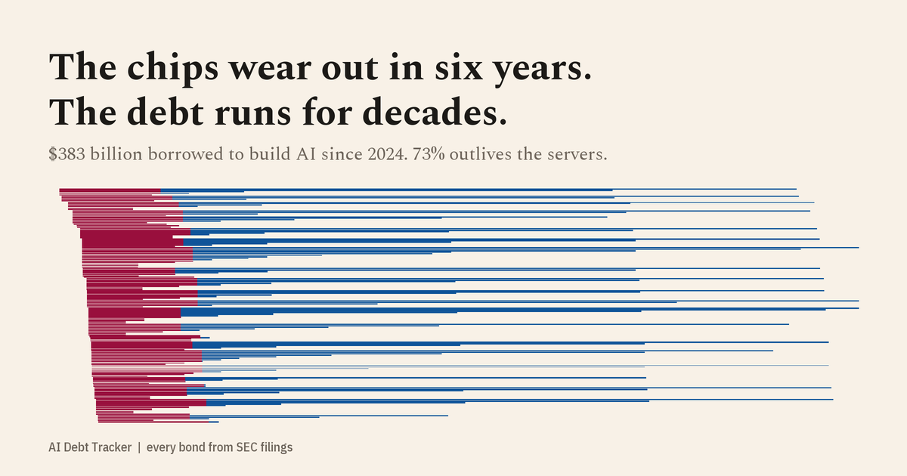

# AI Debt Tracker

**The chips wear out in six years. The debt runs for decades.**



An open dataset and interactive story tracking every bond and loan that AI's biggest spenders have sold since 2024, built from SEC filings, extracted by an LLM, and checked by deterministic finance rules.

## What it shows (dataset version 2026.10.14)

| | |
|---|---|
| Borrowed since Jan 2024 by Meta, Alphabet, Amazon, Oracle and CoreWeave | **$383.3B** across 33 deals, 159 tranches |
| Share still owed after the financed servers are fully depreciated | **73%** |
| Same share if the assets lasted 10 / 20 years | **51% / 34%** (sensitivity, Table 3) |
| Amount-weighted median maturity | **Nov 2035** |
| Longest maturity | Alphabet's **£1bn 6.125% notes due 2126** (a 100-year bond) |
| Oracle 10-year new-issue spread | **95bp (Sep 2024) → 145bp (Feb 2026)**, while the IG index fell 92 → 74bp; fitted 10y curve +47bp vs +10–23bp for peers |
| Raised outside the US dollar market | **20%** (EUR, GBP, CAD, JPY) |
| Debt whose use-of-proceeds language mentions AI at all | **4%** |
| Microsoft | no new bonds; finance leases **$14.9B → $66.6B** (FY22 → FY26) |
| Data-center leases signed but not yet commenced (off balance sheet) | **$1.15T**, 3.0× the bonds; Microsoft $329B, Oracle $288B, Meta $279B (Table 2) |
| Capex growth vs cloud revenue growth, latest fiscal year | Oracle **+162% vs +39%**, Microsoft +80% vs Azure +41%, Meta +87% vs revenue +22% (Figure 9) |
| Interest coverage (TTM operating income ÷ interest) | Oracle **4.5×**, CoreWeave **−0.1×**; the other four at least 28× (Figure 10) |

Every number above is computed from `data/public/`, and every tranche links to the SEC filing it came from.

## What's on the page

The site is laid out like a working paper: abstract, key findings, numbered figures and tables with notes, objections and references.

| | |
|---|---|
| **Figure 1** | Every tranche as a line from pricing to maturity: claret while the financed servers are in service, blue after. Includes a maturity histogram and the median-maturity line. |
| **Table 1** | Descriptive statistics by issuer: principal, non-USD share, coupon, term, spread, server life, and the share due after write-off. |
| **Figures 2–4** | Cumulative borrowing, every deal by size, and ten-year new-issue spreads against the ICE BofA IG/BBB indices. |
| **Figure 5** | Per-issuer credit curves (spread on log maturity), 2024–25 vs 2026. |
| **Figure 6** | Capex vs operating cash flow vs total debt, from XBRL. |
| **Figure 7** | Quarterly capex by company (aligned to calendar quarters) with combined capex ÷ revenue; toggle to calendar years. |
| **Figure 8** | Funding-gap waterfall for any company and fiscal year: operating cash flow − capex − dividends − buybacks, then how the gap was filled (net debt, cash drawn down, other flows). The note reconciles it with the bonds in this dataset. |
| **Figure 9** | Small multiples: capex growth vs cloud revenue growth, year over year, on each company's own disclosed cloud measure. |
| **Figure 10** | Interest coverage over time (symmetric-log scale); Oracle and CoreWeave highlighted. |
| **Figure 11** | The depreciation wave: depreciation of capex already spent, projected five years ahead, against reported depreciation and latest revenue. Sliders for server life and server share of capex. *Illustrative.* |
| **Table 2** | Leases signed but not yet commenced, and Meta's off-balance-sheet joint venture, with verbatim quotes. |
| **Figures 12–13, Table 3** | Asset life vs debt term; debt outstanding vs remaining book value, with an asset-life slider; the sensitivity table. |
| **Figure 14** | Maturity wall. |
| **Explorer** | Filter, brush and sort all 160 tranches. The URL keeps the view, and the selection exports to CSV. |

Every chart can be embedded (`/embed/<id>/`) or saved as a PNG.

The visual language is deliberate. Claret always means hardware that wears out (capex, depreciation) and blue always means debt. A third, neutral ink, `--flow` (#4a443d, the palette's secondary ink), marks money coming in: operating cash flow and revenue. Issuers are identified by their logos, shown unmodified for identification only; sources and a trademark notice are in `web/src/assets/logos/SOURCES.md`. A hand-drawn chip-to-bond illustration and line icons (`web/src/components/icons.tsx`) carry the same color code.

## How it works

```
SEC EDGAR (FWP term sheets, 8-Ks)          FRED (ICE BofA OAS, H.10 FX)    SEC XBRL (capex, cash flow, debt)
        │                                           │                                 │
   discover ─▶ fetch ─▶ extract (Claude) ─▶ validate ─▶ dedupe ─▶ enrich ──────────────┴─▶ publish ─▶ Astro site
                              │                 │
                   extraction cache        review queue ◀── overrides.yaml (human sign-off, with reasons)
                (committed, auditable)
```

* **Extraction**: an LLM reads each filing and returns every tranche, with a verbatim quote for each one ([`pipeline/aidebt/extract.py`](pipeline/aidebt/extract.py)). Results are cached in `pipeline/extractions/`, so re-runs are free and deterministic, and every extraction can be reviewed in a PR.
* **Validation** ([`validate.py`](pipeline/aidebt/validate.py)) rejects anything that fails a finance identity:
  * quotes must appear word for word in the filing;
  * `spread ≈ YTM − benchmark yield` within 5bp;
  * the YTM recomputed from price, coupon and dates must match within 5bp.

  Failures go to `data/review/queue.json` and are never published unreviewed.
* **Evaluation** ([`evaluate.py`](pipeline/aidebt/evaluate.py)) compares the pipeline's output with an independently labelled gold set: 16 filings, 87 tranches, labelled blind by a different model. Current score: **100%** tranche recall and precision, and 100% on amount, maturity, coupon and spread. CI fails on any miss, and another test injects errors to confirm the eval catches them.

## Run it

```bash
# data pipeline (Python 3.9+)
cd pipeline
pip install -r requirements.txt
export SEC_USER_AGENT="Your Name you@example.com"   # SEC fair-access rule
python -m aidebt.run          # discover → extract → validate → publish to data/public/
python -m aidebt.evaluate     # score extractions against eval/labels/
pytest -q

# website (Node 22)
cd ../web
npm install
npm run dev                   # http://localhost:4321
npm run build                 # static site in web/dist/
```

New filings that are not in the extraction cache are sent to Claude when `ANTHROPIC_API_KEY` is set. Without a key they go to the review queue.

## Repository map

| Path | What |
|---|---|
| `pipeline/aidebt/` | discover, fetch, extract, validate, enrich, run, evaluate |
| `pipeline/config/issuers.yaml` | who is tracked and why |
| `pipeline/config/useful_life.yaml` | server depreciation lives, quoted from each 10-K |
| `pipeline/config/off_balance_sheet.yaml` | JV/SPV financing (not in totals), with filing quotes |
| `pipeline/config/overrides.yaml` | human corrections, each with a reason |
| `pipeline/config/segments.yaml` | how each issuer's cloud revenue is read from its filings |
| `pipeline/config/lease_commitments.yaml` | leases not yet commenced, with verbatim quotes |
| `pipeline/config/assumptions.yaml` | illustrative depreciation-wave parameters |
| `pipeline/aidebt/quarterly.py`, `segments.py`, `assets.py`, `asset_side.py` | quarterly XBRL, segment extraction, asset-side metrics |
| `pipeline/extractions/` | LLM extraction cache, one JSON per filing |
| `eval/labels/` | independent gold labels |
| `data/public/` | the published dataset (CSV + JSON) |
| `web/` | Astro + React + D3 site; every chart is embeddable at `/embed/<chart>/` |
| `docs/superpowers/specs/` | design document |

## Methodology notes

* **What counts.** All debt issued by the tracked companies since 2024-01-01, not only debt earmarked for AI. Their filings almost always say "general corporate purposes". The `ai_flag` field separately marks deals whose proceeds language names AI, GPUs or data centers.
* **Excluded from totals.** Revolving credit lines (they are commitments, not borrowing), leases, and off-balance-sheet JVs. Meta's Louisiana venture is covered separately, using the figures from Meta's own 10-K.
* **Delayed-draw term loans** are counted at their full committed size.
* **Non-USD tranches** are converted at the H.10 rate on the pricing date.
* **Spreads** are as priced at issue. There is no free bulk source for secondary-market prices.

### Asset side: where the money goes and whether it can be serviced

* **Quarterly fundamentals** (`pipeline/aidebt/quarterly.py`, published as `data/public/quarterly.json`) come from the SEC XBRL company-facts API, reading 10-Qs and 10-Ks.
  * Cash-flow statements in 10-Qs are year-to-date, so single quarters are differenced: Q4 = full year − nine months.
  * Income-statement quarters are used as reported. Balance-sheet items are point-in-time values.
  * Fiscal years are each company's own: Microsoft's ends in June and Oracle's in May. A fiscal year is named for the calendar year it ends in.
  * Every value records its XBRL tag, its derivation method and the accession number(s) of its source filing(s).
* **Tag fallbacks.** For each field, the first tag in the list that has a value for the period is used.

  | Field | Tags, in order |
  |---|---|
  | revenue | `Revenues`, `RevenueFromContractWithCustomerExcludingAssessedTax` |
  | operating_income | `OperatingIncomeLoss` |
  | interest_expense | `InterestExpense`, `InterestExpenseNonoperating`, `InterestExpenseDebt` |
  | depreciation | `DepreciationDepletionAndAmortization`, `DepreciationAmortizationAndAccretionNet`, `Depreciation` |
  | dividends | `PaymentsOfDividends`, `PaymentsOfDividendsCommonStock`, plus `PaymentsOfOrdinaryDividends`, which Alphabet uses from 2026 Q2 after issuing preferred stock |
  | buybacks | `PaymentsForRepurchaseOfCommonStock` |
  | cash_and_securities | `CashCashEquivalentsAndShortTermInvestments`, otherwise cash plus the first short-term securities tag |

  The quarterly debt flows add Microsoft's `…DebtMaturingInMoreThanThreeMonths` tags and Alphabet's `RepaymentsOfDebtAndCapitalLeaseObligations`. The existing annual `fundamentals` in `issuers.json` are unchanged.
* **Gaps in the tagged data.**
  * Amazon and CoreWeave report no dividend tag (they pay no dividend), and Amazon has reported no buybacks since 2024.
  * In the funding gap, a missing item is read as zero only if the company reported nothing but zeros (or nothing at all) for it over the previous eight periods. The chart lists those assumed zeros. Otherwise the period is left blank.
  * Meta's interest expense is tagged in some quarters only, so its coverage line is short.
* **Funding gap.**
  * gap = OCF − capex − dividends − buybacks.
  * net debt = proceeds − repayments of long-term debt.
  * cash drawdown = the change in cash and short-term securities.
  * "other" is the residual, so that gap + net debt + cash drawdown + other = 0 (this identity is tested). The residual covers equity issued, short-term debt and commercial paper, acquisitions and investments, finance-lease principal, and tax withheld on stock awards.
* **Cloud revenue** (`config/segments.yaml`, `data/public/segments.json`) is not in the XBRL API, which omits segment (dimensional) data. It is read from the inline XBRL of each 10-Q/10-K:
  * AWS segment net sales.
  * Google Cloud segment revenue.
  * Oracle's "cloud revenues" (IaaS + SaaS).
  * **Microsoft only discloses Azure growth as a percentage**, so we store the percentage it states and never convert it to dollars.
  * CoreWeave: all revenue.
  * Meta has no cloud segment, so its total revenue is used.

  Every number carries a verbatim quote (the table row, or the sentence for Azure). It goes to `data/review/segments_queue.json` first and is published only if the quote is found in the filing and contains the number.
* **Leases not yet commenced** (`config/lease_commitments.yaml`) are curated by hand, with verbatim quotes that are re-checked against the filing on every run. When a company files a newer 10-Q or 10-K that discloses not-yet-commenced leases, the run flags the entry for update in the review queue. These leases are not counted in the headline.
* **Useful-life changes** in `config/useful_life.yaml` record each disclosed change. Where the company reported the profit impact, they record it too, as `earnings_impact_usd`, with a quote.
* **Depreciation wave (illustrative).**
  * Each fiscal year's capex is split between servers and everything else. The split is set in `config/assumptions.yaml` (default 50%, not disclosed by the companies).
  * Servers are depreciated straight-line, with a half-year convention, over the life in force when the capex was spent. Everything else is depreciated over 20 years.
  * The model projects five years ahead from capex already spent, assuming no new capex, so the projection is a floor.
  * The browser port (`web/src/lib/depreciation.ts`) is tested to reproduce the pipeline's numbers.

### Limits of the asset-side data

* Segment data is not in the SEC XBRL API and has to be read from each filing.
* Microsoft discloses Azure only as a growth rate.
* Capex is split between servers and buildings by assumption.
* Reported depreciation includes finance-lease and intangible amortisation that the model does not cover.
* Interest expense is after capitalised interest, which flatters coverage for heavy builders.

## Deployment in mw_lab

The published site is [AI Debt Tracker on mw_lab](https://oviiy.github.io/mw_lab/tools/ai-debt-tracker/web/dist/). The root `mw_lab` Pages workflow publishes the checked-in `web/dist/` build. This project's original workflows under `.github/` do not run from a subdirectory, so the published data is a snapshot until the pipeline and build are run again.

To rebuild for this location, from `web/` run `npm ci`, `node scripts/copy-data.mjs`, then `SITE=https://oviiy.github.io BASE_PATH=/mw_lab/tools/ai-debt-tracker/web/dist/ npx astro build` (set those two environment variables with your shell's syntax). Commit the refreshed `web/dist/` files with the data update.

To view the site on your own machine, double-click `view.command` in Finder. It builds the site, serves it and opens it in your browser (at http://localhost:4400, or at the preview server that is already running). Alternatively, run `cd web && npm run build && npm run preview` and open http://localhost:4321. Opening `dist/index.html` directly from disk does not work, because browsers block the site's scripts on `file://`.

## Cite

See [`CITATION.cff`](CITATION.cff). Code is MIT ([`LICENSE`](LICENSE)); data is CC BY 4.0 ([`DATA_LICENSE.md`](DATA_LICENSE.md)).

*Not investment advice.*
